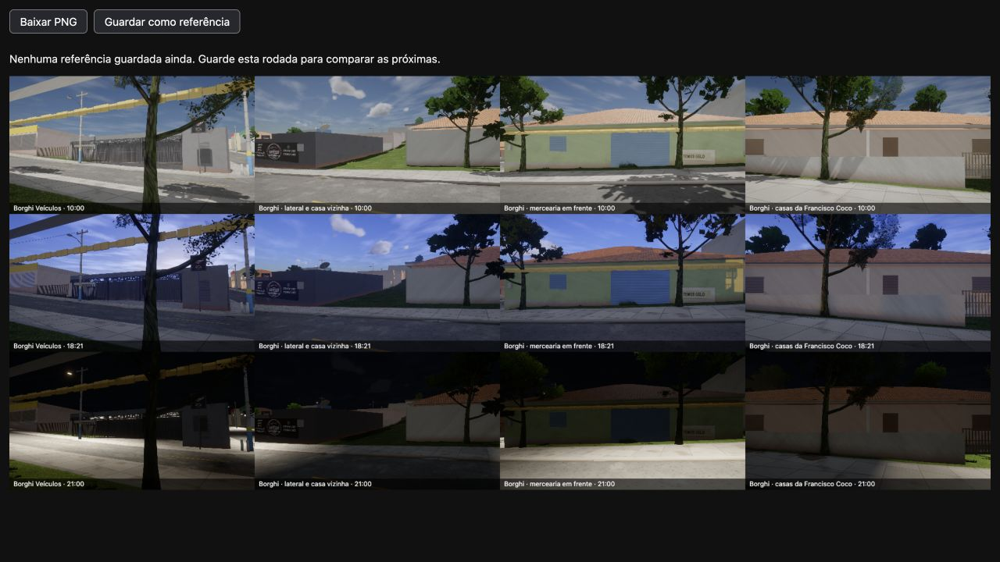

# Mapa de Nova Aliança (SP)

Segundo mapa do jogo, escolhido no menu (**Mapa → Cidade de Nova Aliança**) ou pelo endereço `?mapa=nova-alianca`.

## Origem dos dados

| Arquivo | Conteúdo | Fonte e licença |
|---|---|---|
| `osm-ruas.txt` | Ruas, rodovias, córregos e pontos de interesse num quadrado de 6,4 km em volta da cidade | © colaboradores do [OpenStreetMap](https://www.openstreetmap.org/copyright), licença ODbL. Baixado pela Overpass API em 20/11/2026 |
| `relevo-80m.txt` | Altitude em grade de 81 × 81 pontos (passo de 80 m) | SRTM (NASA), tiles Terrarium da AWS, domínio público |

O traçado vem do OpenStreetMap, não do Google Maps, porque os dados do Google não podem ser copiados. As fotos do Street View
serviram só de referência visual para modelar à mão a Borghi Veículos, a Praça Matriz Padre João Nolte com a Paróquia
Nossa Senhora Aparecida, o Supermercado Sacoi, a casa do Petrus e o estilo das casas, calçadas, postes e placas.

## Formato

Origem em -21.0164, -49.4981 (centro da cidade). Coordenadas em decímetros, X para leste e Z para o sul, como no jogo.
Uma linha por elemento: `tipo|chave=valor^chave=valor|x0,z0 dx,dz dx,dz ...` (`n` ponto, `w` linha). Chaves:
`hw` highway, `nm` name, `rf` ref, `ow` oneway, `sf` surface, `br` bridge, `ly` layer, `ww` waterway, `am` amenity,
`ls` leisure, `lu` landuse, `bd` building, `nt` natural, `sp` sport, `rl` religion, `sv` service, `tn` tunnel, `bb` barrier.

O relevo tem 2 caracteres por ponto (base 88, alfabeto em `source/js/12_city1_core.js`), em decímetros acima de 415,887 m.
`source/js/12_city0_data.js` carrega os dois arquivos dentro do jogo; para regenerá-lo depois de atualizar os textos,
atualize as constantes `CITY_OSM` e `CITY_DEM` com os conteúdos correspondentes e mantenha `CITY_DEM_MIN` coerente com a origem das altitudes. Depois execute `node source/build.mjs`.

## Como o mapa é montado

`12_city1_core.js` lê os dados, recorta a área jogável (3,2 × 2,6 km), monta a malha de vias com cruzamentos de cantos
arredondados, o perfil de altura de cada via, os rasters de 1 m (distância à via, altura, tipo de piso) e os lotes.
`12_city2_world.js` liga a cidade ao jogo (terreno, física, colisão, câmeras). `12_city3_mesh.js` gera as malhas das
ruas, calçadas e casas, e `12_city4_marcos.js` os lugares modelados pelas fotos. `tests/city.cjs` confere tudo sem GPU.

## Estado e verificações em 20/11/2026

No recorte jogável: 608 trechos de vias, 370 cruzamentos, 97 nomes de vias, 58,7 km de ruas e 3.444 casas. O cenário inclui Borghi Veículos, Sacoi, casa do Petrus, Praça Matriz com igreja e entrada da cidade (portal e letreiro), além das fachadas genéricas, calçadas, sinalização e rede de postes. As construções são aproximações visuais.

Execute, a partir da raiz:

```sh
node tests/city.cjs
node tests/city-collide.cjs
node scripts/cidade/auditoria.cjs /tmp/nova-alianca-auditoria.json
```

A auditoria não detectou casas sobre ruas nem construções sobrepostas. Alertas atuais: um ponto do traçado OSM fora da pista gerada, um trecho isolado que sai pela borda, dez rampas fortes, onze pontas de ruas sem saída e 45 trechos urbanos sem nome. As pontas sem saída e os trechos sem nome precisam ser confrontados com os dados de origem; não são necessariamente falhas de montagem. As coordenadas dos alertas ficam no JSON.

O minimapa é alternado com **N**. O horário e o clima são ajustados pelo menu; a opção de clima real usa uma consulta de rede independente dos dados locais do mapa.

A atualização do centro acrescenta fachadas próprias para Banco do Brasil, Padaria do Parque, posto da Polícia Militar, Aliança Saúde e Oquelifibra, além do Paço Municipal com escadaria e rampa. O atlas de letreiros passou a 2048 × 3072 pixels, com espaço para até 56 letreiros comerciais e públicos. O modo de fotos inclui câmeras para esses novos pontos.

## Quarteirão da Borghi — revisão visual

Referências observadas no [Google Street View](https://www.google.com/maps/@?api=1&map_action=pano&pano=pkdCqpWt8CB7H-VRR8VBWw&heading=198&pitch=5): esquina da Rua do Comércio com a Rua Francisco Coco, captura de outubro de 2024. Também foi observada a frente pela vista `hR1t4RTFW9tWGS5DwxUOvg` e pela vista `_zJ_UJPGI-_CxGjhVvSElQ` (Rua do Comércio, ao sul da esquina).

A reconstrução inclui a mercearia verde de portas azuis e toldo amarelo em frente à Borghi, a casa de esquina cor salmão, a residência com jardim e muro baixo do outro lado da Francisco Coco, a casa com muro alto ao lado da loja e o quintal gradeado entre a Borghi e a oficina. Esses cinco lotes substituem as construções genéricas que os ocupavam. Árvores de copa arredondada são posicionadas manualmente e o terreno dos lotes recebe acabamento local, preservando os perfis das ruas.

Na loja foram revistos o encaixe entre galpão e colisão, a profundidade do piso e do salão, a grade da frente, o trilho, a antena e a parabólica. Na Francisco Coco, a pintura de aproximação usa PARE e linha de retenção, substituindo as faixas de pedestres genéricas nessa esquina.

As imagens foram usadas apenas para observação: não são distribuídas nem aplicadas como texturas. Medidas, posições no traçado OSM e partes não visíveis são aproximadas; esta versão não é um levantamento arquitetônico nem uma reprodução exata de toda a quadra.

Fontes: `source/js/12_city5_borghi.js` (lotes, fachadas e pintura) e `12_city4_marcos.js` (loja). A prancha de conferência em três horários é aberta com `?mapa=nova-alianca&fotos=borghi`.


