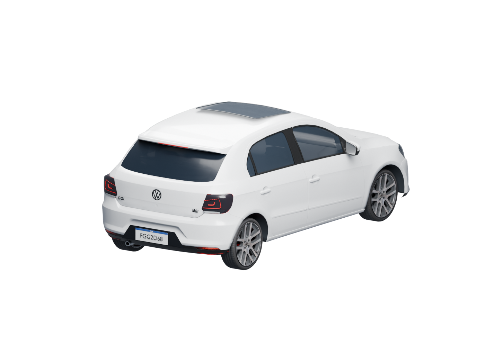
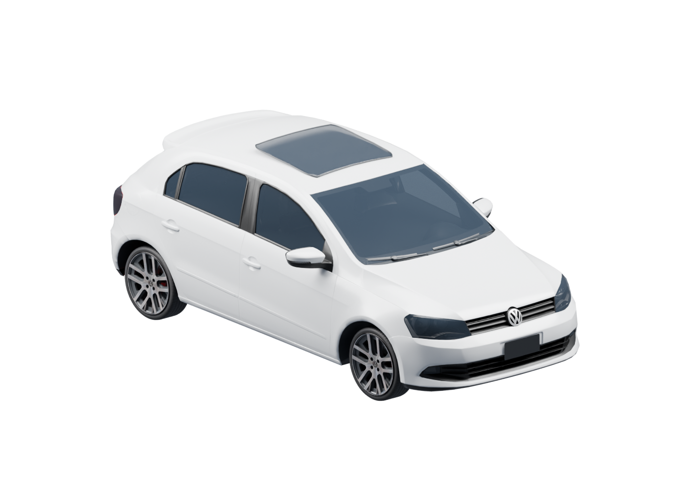
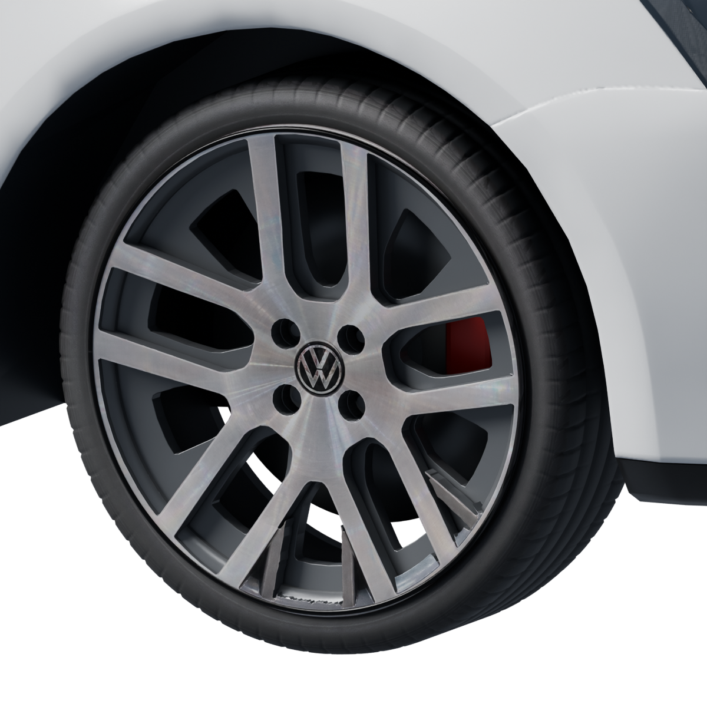

# Gol branco com teto solar e rodas aro 17

[Baixar o modelo editável do Blender](gol-branco.blend)

O arquivo inclui a carroceria branca, teto solar editável, quatro instâncias da roda aro 17, pneus de perfil baixo com textura e sulcos, aerofólio com faixa preta estreita, lanternas fumê, aplique reduzido no nicho da placa e emblemas GOL, MSI e VW.

As texturas e a fonte dos emblemas estão incorporadas no arquivo. A escala visual utiliza um comprimento de referência de 3,897 m. Perfil, largura e sulcos dos pneus e detalhes internos das lanternas foram reconstruídos visualmente a partir das imagens fornecidas.

## Prévias

## Origem e créditos

A geometria-base e os mapas originais são do modelo [VW Gol GT 2017 Low Poly](https://sketchfab.com/3d-models/vw-gol-gt-2017-low-poly-e965f27d3148498c8b5802e8443f5b94), de **FreddieSign**. A API do Sketchfab informa a licença [Editorial](https://sketchfab.com/licenses). Essa informação de licença acompanha este modelo-base e suas adaptações.

As alterações de carroceria, teto solar, rodas, pneus e traseira foram produzidas a partir das referências do proprietário. Os demais créditos e a licença do jogo estão no [README principal](../../README.md).
