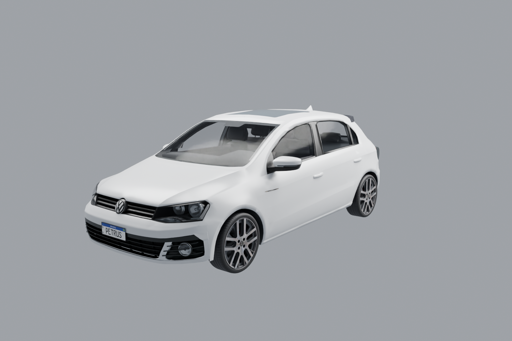
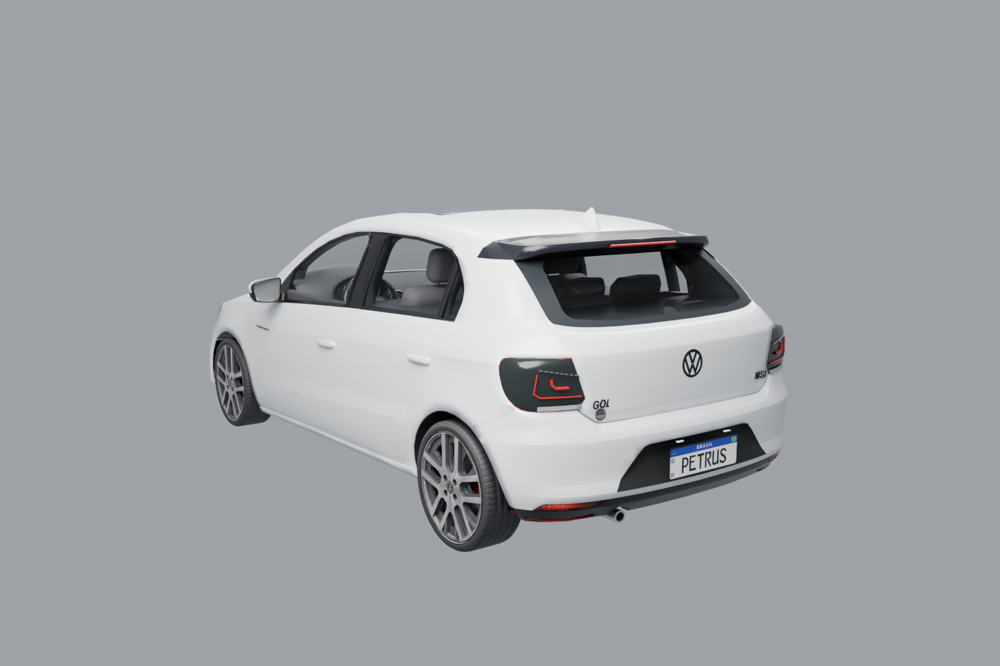
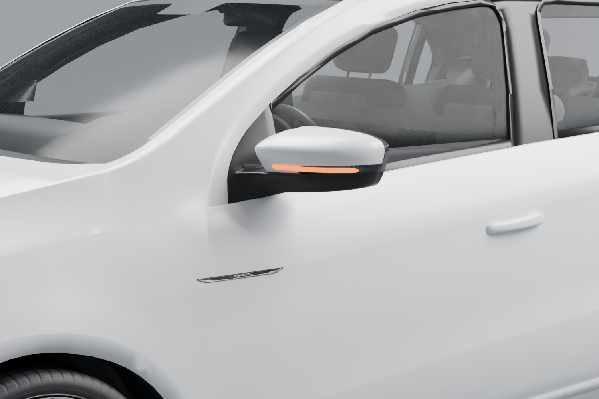
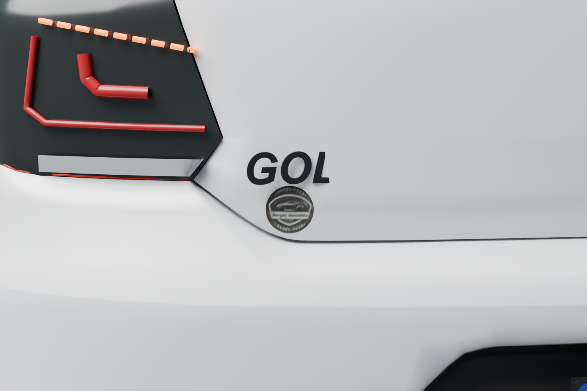

# Revisão do Gol — 20/11/2026

Para-choque dianteiro reconstruído por contornos da foto fornecida: três lâminas centrais, nervuras internas, cavidades laterais, divisórias brancas inclinadas e dois neblinas com refletor, lente e aro. Laterais originais e caixas das rodas preservadas; pontos nas pontas da grade removidos.

Emblemas laterais pequenos posicionados na emenda porta/para-lama, abaixo dos retrovisores, com leitura do GOL corrigida nos dois lados. O afastamento vertical da base do retrovisor foi aumentado em 20%, deslocando-os 37,6 mm para baixo. Aerofólio preto integral com malha dividida na linha da emenda, sem classificação pela posição do centro dos triângulos.

Calha preta entre para-brisa e capô, vidro do teto com curvatura contínua, moldura plana de 7 mm e vedação reduzida. O defletor aparece no jogo somente durante a abertura. Antena branca centralizada atrás do curso do vidro e à frente do aerofólio, com separação longitudinal de 45 mm do vidro completamente aberto.

Traseira com lentes fumê, adesivo Borghi em círculo sobre o plano tangente da tampa, imagem retificada da perspectiva elíptica da foto e dois LEDs de placa. Placa PETRUS preservada.

## Comandos do jogo

- L: farol baixo; K: alto. Alto liga também o baixo; desligar o farol desliga o alto.
- Z / X: seta esquerda / direita; repetir cancela; as duas não ficam ligadas simultaneamente.
- J ou botão pressionado: buzina sintetizada de duas frequências. Pausa, troca de carro, perda de foco e aba oculta encerram a buzina; M também silencia a buzina.
- I: luz branca forte da placa, independente dos faróis.

Setas têm lentes dedicadas nos faróis, duas faixas curvas nos retrovisores e 18 células superiores nas lanternas traseiras. Todos os indicadores do mesmo lado usam o mesmo canal e o mesmo relógio. A ré permanece branca, independente das setas. O defletor é uma tela curva preta recolhida abaixo da chapa; o antigo bloco plano foi removido.

Fachos dos faróis e iluminação próxima da placa são calculados no passe de iluminação. Não há sombras adicionais dedicadas para essas luzes. Os comandos são exclusivos do Gol; o Civic permanece preservado.

## Arquivos e reprodução

Os scripts usam as fotos locais fornecidas e a cópia anterior à revisão em `.local-backups/bumper-2026-11-20/`. Para refazer do início: `refine-front-bumper.py`, `add-side-badges.py`, `paint-rear-spoiler.py`, `refine-roof-and-cowl.py`, `refine-rear-details.py`, `refine-turn-signals.py`, exportador base, captura e `sync-exterior.py`. A sincronização troca somente os buffers de exterior/vidros/teto, preservando as edições do interior e os controles da cena modular.

Prévias: `python scripts/gol/render-bumper-review.py`. Reconstrução visual por fotografias; as profundidades e medidas são ajustadas ao modelo existente, sem escaneamento dimensional.

## Reproduzir a base da revisão

A cópia anterior ao novo para-choque pode ser recuperada do histórico público:

```sh
mkdir -p .local-backups/bumper-2026-11-20
git show 2c19b61:modelo/blender/gol-branco.blend > .local-backups/bumper-2026-11-20/gol-branco.blend
```

As fotos originais continuam locais. Para montar o jogo sem refazer a modelagem, use os arquivos `.blend`, os atlas e os buffers exportados desta versão. A sincronização também atualiza as UVs das rodas quando o atlas muda e recalibra os pivôs do teto pela configuração exportada.

## Prévias








